<div align="center">



# Soprano

**A native tiling multiplexer for running a room full of AI coding agents — on macOS, Linux
and Windows.**

Codex, Claude Code, and OpenCode side by side in real GPU-rendered terminals — every
pane says what its agent is doing, and your desktop tells you which one is waiting on you.


**[frknue.github.io/soprano-site](https://frknue.github.io/soprano-site/)** ·
[Changelog](CHANGELOG.md) · [Contributing](AGENTS.md)

```bash
brew install --cask frknue/tap/soprano
```

[Install options](#install) · [First five minutes](#the-first-five-minutes) ·
[Shortcuts](#keyboard-shortcuts) · [Settings](#settings)

</div>

```
┌ ◧ Session 1 ⌄ ────────┬─ Codex ─────── ◌ Working 2m ─┬─ Claude Code ────── ⓘ Input ─┐
│ ⌕ Search              │ • editing SplitNode.swift    │ Drop the legacy column? [y/n]│
│ soprano 2 ⌄           │ • 3 files changed            │ >                            │
│  SO soprano ◌ Working │                              │                              │
│  Codex                ├─ Terminal 1 ─────────────────┴──────────────────────────────┤
│  SO soprano  ⓘ Input  │ > swift test                                                │
│  Claude Code          │ Executed 142 tests, 0 failures                              │
│ webapp 1 ⌄            │ >                                                           │
├───────────────────────┴─────────────────────────────────────────────────────────────┤
│ Normal  work / soprano / Claude Code          1 needs you   ⌘P Commands   ⌃A Prefix │
└─────────────────────────────────────────────────────────────────────────────────────┘
```

## Why

One agent is easy. Four is a scheduling problem. They run asynchronously, they all
stop to ask you something eventually, and terminal tabs hide the one that is blocked.
Soprano is built around the question you actually have all day: *which agent needs me
right now?*

- **Panes report their own status.** Starting · Working (with its duration) · Done ·
  Approval · Input · Failed · Stopped, driven by real agent lifecycle hooks rather than
  output scraping.
- **Notifications say what happened, and where.** `Claude Code needs approval` over the
  conversation's name; clicking one activates Soprano and focuses that exact tab.
- **A real terminal.** Every pane runs [libghostty-vt](https://github.com/ghostty-org/ghostty),
  Ghostty's terminal core, drawn on the GPU with [GPUI](https://www.gpui.rs). No Electron,
  no web view, no reimplemented VT parser.
- **Tabs.** Every window holds a row of tabs, each with its own split layout, so one
  window can carry several complete layouts while every agent in them keeps running.
- **A browser your agents can drive.** `⌘B` splits a native web view pane (WebKit on
  macOS and Linux, WebView2 on Windows); `"$SOPRANO_BIN" browser click @e1` works from
  inside any terminal.
- **Documentation beside the work.** Open a local Markdown file in a themed reader that
  follows edits as an agent writes them.
- **Layouts that come back.** The last workspace restores on launch, and `⇧⌘S` saves
  named sessions.

## Install

### macOS

Install the latest universal build with Homebrew:

```bash
brew install --cask frknue/tap/soprano
```

Or download `Soprano-<version>.dmg` from
[GitHub Releases](https://github.com/frknue/soprano/releases/latest), open it, and drag
Soprano into **Applications**.

> [!IMPORTANT]
> Soprano is ad-hoc signed but not notarized because the project does not have a paid
> Apple Developer membership. On first launch, macOS may block it. If that happens,
> open **System Settings → Privacy & Security**, scroll to **Security**, click
> **Open Anyway** for Soprano, then confirm **Open**. Apple documents this
> [one-time override](https://support.apple.com/guide/mac-help/mh40616/mac).

**Requirements:** macOS 14 Sonoma or newer on Apple Silicon or Intel.

### Linux

Download `soprano-<version>-linux-<arch>.tar.gz` (x86_64 or aarch64) from
[GitHub Releases](https://github.com/frknue/soprano/releases/latest) and unpack it into a
prefix, for example `~/.local`:

```bash
tar -xzf soprano-*-linux-x86_64.tar.gz -C ~/.local
```

That installs `bin/soprano`, its resources under `share/soprano`, and a desktop entry.
Soprano needs a desktop session with Vulkan; the browser pane uses WebKitGTK
(`libwebkit2gtk-4.1`) and runs under X11 or XWayland.

### Windows

Download `soprano-<version>-windows-x64.zip` from
[GitHub Releases](https://github.com/frknue/soprano/releases/latest), unpack it anywhere,
and run `soprano.exe`. Windows 10 1809 or newer; the browser pane uses the WebView2
runtime that ships with Windows 11 and current Windows 10.

Every release contains Soprano, libghostty-vt, and Ghostty's shell integration and
terminfo; installing it does not require Rust, Zig, Ghostty, or a source checkout.

<details>
<summary><b>Build from source</b></summary>

You need stable Rust (see `rust-toolchain.toml`), Zig 0.16 for libghostty-vt, and, to
package the omp web app, Node.js 22.19.0 or newer with npm. Linux also needs the GPUI and
WebKitGTK development packages listed in `.github/workflows/ci.yml`.

```bash
brew install zig@0.16 node            # macOS; elsewhere install Zig 0.16 from ziglang.org
git clone --recurse-submodules https://github.com/frknue/soprano.git
cd soprano
./scripts/prefetch-zig-deps.sh        # fetches Ghostty's Codeberg dependency over git
cargo build --release -p soprano
```

`crates/ghostty-sys` builds libghostty-vt from the `ghostty` submodule with Zig on the first
build (it finds Homebrew's keg-only `zig@0.16`, or set `ZIG`). To move Ghostty, check out
another commit in the submodule, run the prefetch script again, and commit the pin.

Install the result:

- macOS: `./scripts/install.sh` builds a release, packages `Soprano.app`, signs it with a
  stable local identity so macOS keeps your notification permission across rebuilds, and
  replaces `/Applications/Soprano.app` **without** stopping a running instance — the
  update applies on the next launch. Install elsewhere with
  `SOPRANO_INSTALL_DIR="$HOME/Applications" ./scripts/install.sh`.
- Linux: `./scripts/install-linux.sh` installs into `~/.local` (`SOPRANO_INSTALL_PREFIX`
  picks another prefix).
- Windows: `pwsh scripts/package-windows.ps1` writes the release zip to `dist\`.

</details>

## The first five minutes

Launch Soprano, then:

| Press | And |
|---|---|
| `⌘2` | Claude Code launches in the active pane; the header takes its color and starts reporting status |
| `⌃A` then `\|` | Split vertically. `⌃A` is the tmux-style prefix; `-` splits horizontally |
| `⌘1` | Codex starts in the new pane |
| `⌘4` | omp (Oh My Pi) starts in a new agent pane |
| `⌘I` | omp opens as a chat beside the pane: the same agent as a conversation with a composer instead of a terminal |
| `⌃H` `⌃J` `⌃K` `⌃L` | Move between panes — no prefix needed |
| `⌘B` | A browser pane splits off to the right |
| *drag a file from Finder onto a terminal* | Its shell-safe path is inserted at the cursor |
| `⌃A` then `M` | Maximize the active pane, and again to restore it |
| `⌃A` then `I` | Dive into that pane's private inner workspace; `O` comes back out |
| `⌃A` then `⇧C` | Create a named session for a separate project |
| `⌃A` then `C` | Create a window inside the current session; `P` / `N` moves between its windows |
| `⌃A` then `S` | Switch sessions while their terminals keep running |
| *hold* `⌃` | The sidebar reveals its window and pane jump hints |
| *switch away, let an agent finish* | A desktop notification such as `Claude Code finished`, plus an attention outline on the pane |
| `⌘P` | Command palette for everything above |

## Agents that report in

Every Soprano terminal exports pane metadata for lifecycle hooks. The built-in agent
launchers configure those hooks per launch, without changing your global configuration:

- **Codex** — its external turn notifier plus OSC approval notifications.
- **Claude Code** — launch-scoped `SessionStart`, `UserPromptSubmit`, `Stop`, and
  permission hooks.
- **OpenCode** — OpenCode 2 runs every session in one shared background server that
  never sees a pane's environment, so a launch-scoped plugin reports from its terminal
  UI through `OPENCODE_CLI_CONFIG_CONTENT`; the plugins in your own `cli.json` keep
  loading. OpenCode 1.x gets a server plugin through `OPENCODE_CONFIG_CONTENT`.
- **omp (Oh My Pi)** — a launch-scoped extension reports session, turn, and tool
  approval events; install the [`omp` CLI](https://omp.sh/docs/cli) separately.
  Soprano runs its interactive terminal client, not the Bun-only SDK.

When a background agent finishes, macOS shows a notification and the pane gets an
attention outline. The notification is two short lines: what the agent wants — `Claude Code
finished`, `Codex needs approval`, `omp needs input`, `OpenCode failed` — over the tab's
title, which agents set to the conversation's name (the window or session stands in while
the tab is still named after the agent). Each tab keeps one banner, so a new one replaces
the last instead of stacking. Plain terminals that post their own notifications keep
their title and body, subtitled `session ▸ window ▸ pane`. Clicking one activates
Soprano and focuses that tab. Pane headers, sidebar cards, and the dashboard show the
agent's status as a pill: Starting, Working with its duration, Done, Approval, Input,
Failed, or Stopped. Focusing the relevant tab clears its unread marker, and a completed
turn stays Done until the next prompt is submitted.

Plain terminals report too. While a shell runs a command — `npm run dev`, a build, an
editor — its pane header shows `RUNNING` beside a cyan dot, its tab in the pane's tab
strip gets a cyan `●`, and its sidebar row shows `RUNNING` in cyan. The mark
clears when the shell is back at its prompt. Detection reads ghostty's shell-integration
prompt marks (bash, zsh, fish, elvish, nushell), so a shell without them shows nothing.
A tab running an agent keeps showing the agent's status instead.

Soprano asks for notification permission at launch. Notifications are only sent for
panes that are **not focused** — a pane you are looking at updates its status without
interrupting you. Banners are silent by default; enable *Play a sound* under
**Settings ▸ General ▸ Notifications**, or set `notifications.sound` in `settings.json`.

That same section reports whether macOS is allowing banners at all. Denying the prompt
leaves the in-app attention outline as the only signal, and because macOS only ever asks once,
Soprano cannot re-prompt — the section links straight to
**System Settings → Notifications → Soprano** instead.

<details>
<summary><b>Agents you start yourself — aliases, scripts, plain <code>omp</code> or <code>opencode</code> in a shell</b></summary>

To recognize agents started outside the built-in launchers, install their lifecycle
integration separately:

- **Codex:** merge [`resources/AgentHooks/codex-hooks.json`](resources/AgentHooks/codex-hooks.json)
  into `$CODEX_HOME/hooks.json` (normally `~/.codex/hooks.json`). Start Codex once, open
  `/hooks`, and trust the new command hooks.
- **Claude Code:** merge the `hooks` entries from
  [`resources/AgentHooks/claude-settings.json`](resources/AgentHooks/claude-settings.json)
  into `~/.claude/settings.json`.
- **omp:** enable its ambient extension once after installing Soprano:

  ```bash
  mkdir -p ~/.omp/agent/extensions
  ln -s /Applications/Soprano.app/Contents/Resources/Soprano_Soprano.bundle/SopranoOmpAmbient.js \
    ~/.omp/agent/extensions/soprano-omp.js
  ```

  From a source checkout, `./scripts/install-omp-extension.sh` does the same
  without replacing an existing file. Set `PI_CODING_AGENT_DIR` for an isolated
  omp profile. The extension does nothing outside Soprano and does not duplicate
  events from the `⌘4` launcher. An omp process already running when you install
  it must exit and resume (`omp --resume <session-id>` or `omp --continue`) to
  load it; restarting Soprano alone does not inject hooks into that process.
- **OpenCode 2:** link its shell integration once after installing Soprano:

  ```bash
  mkdir -p ~/.config/opencode/plugins
  ln -s /Applications/Soprano.app/Contents/Resources/Soprano_Soprano.bundle/SopranoOpenCodeAmbient \
    ~/.config/opencode/plugins/soprano
  ```

  From a source checkout, `./scripts/install-opencode-plugin.sh` does the same
  without replacing an existing entry (it honors `XDG_CONFIG_HOME`). The plugin does
  nothing outside Soprano and does not duplicate events from the `⌘3` launcher. Quit
  and restart an `opencode` that was already running to load it.

The paths above are the macOS app's. On Linux the same `Soprano_Soprano.bundle` folder is
in `share/soprano/` of the prefix you installed into (`~/.local/share/soprano/` by default);
on Windows it is in `resources\` beside `soprano.exe`.

Preserve existing hook groups when merging Codex or Claude Code hooks. The commands
no-op outside Soprano, and the first lifecycle event automatically associates the
current terminal tab with the reported agent. This works for any launcher whose
underlying agent process inherits the Soprano terminal environment.

</details>

## Keyboard shortcuts

`⌃A` is the prefix. **Settings → Keyboard Shortcuts** (`⌘,`) lists every binding below
with its id; rebind one under `keybindings.bindings` in [`settings.json`](#settings). The
prefix key, its timeout, and the resize step sit under **Settings ▸ General ▸ Keybindings**:
click the prefix keycap (or focus it and press `Space`), then press the new
key; `Esc` keeps the current one.

The tables use macOS keys. On Linux and Windows, `⌘` means `Ctrl+Shift` (the convention
terminal emulators use there, so plain `Ctrl` chords stay with the shell), `⇧⌘` means
`Ctrl+Shift+Alt`, and `⌃⌘` means `Ctrl+Alt`; Settings, the command palette and the status
bar show the real keys. `⌃` chords — the `⌃A` prefix, `⌃H/J/K/L`, `⌃1`…`⌃9`, `⌃Tab` — are
`Ctrl` everywhere. Pane jump hints use `Alt+Shift` there, because `Ctrl+Shift`+letter is
already every `⌘`+letter shortcut. Where two shortcuts land on the same keys, the first
one in **Settings → Keyboard Shortcuts** wins (`⌘L`, toggle right sidebar, has no default
there; bind one in `settings.json`).

**Panes**

| Shortcut | Action |
|---|---|
| `⌃H` / `⌃J` / `⌃K` / `⌃L` | Focus the pane left / down / up / right |
| `⌃A` → `-` / `\|` | Split horizontal / vertical |
| `⌃A` → `H/J/K/L` | Resize the active pane left / down / up / right by 5% |
| `⌃A` → `M` | Toggle maximize for the active pane |
| `⌃A` → `Q` | Close the active pane |
| `⌃A` → `X` / `⌘W` | Close the active pane tab, or the pane when it has only one |

**Sessions, windows, and tabs**

| Shortcut | Action |
|---|---|
| `⌃A` → `⇧C` | Create a named session |
| `⌃A` → `S` | Search and switch sessions |
| `⌃⇧H` / `⌃⇧L` | Previous / next logical window |
| `⌃A` → `P` / `N` | Previous / next logical window |
| `⌃A` → `⇧L` | Jump to the most recently active logical window; press again to toggle back |
| `⌃1`…`⌃9` | Select logical window 1–9 |
| `⌃⇧` + the letters shown in the sidebar | Select the matching pane across windows in the current session |
| `⌘N` | New logical window |
| `⌃A` → `C` | New logical window in the active terminal's directory |
| `⇧⌘R` / `⇧⌘W` | Rename / close the active logical window |
| `⌃Tab` / `⌃⇧Tab` | Next / previous tab (wraps around) |
| `⌘T` or `⌃A` → `T` | New tab |
| `⌃A` → `W` | Close tab |
| `⌃⌘T` / `⌃⌘→` / `⌃⌘←` / `⌃⌘W` | New pane tab / next / previous / close pane tab (in the focused split) |
| `⌃A` → `⇧T` / `>` / `<` / `⇧W` | The same, with the prefix |

**Agents and panes to open**

| Shortcut | Action |
|---|---|
| `⌘1` / `⌘2` / `⌘3` / `⌘4` | Launch Codex / Claude Code / OpenCode / omp |
| `⌘I` | New omp chat beside the focused pane |
| `⌘D` | New terminal pane beside the focused one |
| `⌘B` | New browser pane |
| `⌘L` | Focus the address bar of the focused browser pane (elsewhere it toggles the right sidebar) |
| `⌘[` / `⌘]` / `⌘R` | Browser back / forward / reload |

**App**

| Shortcut | Action |
|---|---|
| `⌘P` | Command palette; `Esc` or a click outside it closes it |
| `⇧⌘D` | Open the Agent Dashboard |
| `⌘F` | Search and switch to a logical window |
| `⇧⌘P` | Search configured projects or choose a directory |
| `⌘,` | Settings |
| `⌘E` | Toggle sidebar |
| `⌘L` | Toggle the right sidebar (in a browser pane, `⌘L` focuses its address bar) |
| `⇧⌘E` | Show and focus the file explorer; press again while it has focus to hide it |
| `⇧⌘G` | Show and focus Source Control; press again while it has focus to hide it (the file editor keeps `⇧⌘G` for find) |
| `⌃A` → `G` | Open the active tab's Git repository in Soprano Git |
| `⌘S` / `⌘F` | Save / find in the file editor |
| `⇧⌘S` | Save workspace as… (all sessions and their layouts) |
| `⌘=` (or `⌘+`) / `⌘-` / `⌘0` | Zoom in / out / reset |
| `⌃A` → `[` / `]` | Enter Vim-style terminal copy mode |
| `⌃A` → `⌃A` | Send a literal `⌃A` to the terminal |

Holding Control reveals the window and pane hints in the sidebar. Pane hints include `⇧`
because they require Control+Shift; unmodified alphabetic Control chords remain available
to the terminal. Every pane gets a hint: past 20 panes the last ones take two letters,
like Vimium link hints. Type the first with Control+Shift (`⌃⇧Z`), then the second with or
without the modifiers; the sidebar narrows to the panes still matching, and `esc` cancels.

**In a terminal pane** (macOS, as in Ghostty)

| Shortcut | Sends | Usually does |
|---|---|---|
| `⌘⌫` | `^U` | Delete the whole input line |
| `⌘←` / `⌘→` | `^A` / `^E` | Jump to the start / end of the line |
| `⌥←` / `⌥→` | `ESC b` / `ESC f` | Move one word left / right |

Terminals read your Ghostty config (`~/.config/ghostty/config`, then
`~/Library/Application Support/com.mitchellh.ghostty/config` on macOS): font, cursor,
scrollback, clipboard, padding, `macos-option-as-alt`, shell integration, and `keybind`
lines that send text to the program (`text:`, `esc:`, `csi:`, `ignore`, `unbind`,
`keybind = clear`). For example `keybind = shift+enter=text:\x1b\r` makes `⇧⏎` a newline
in Claude Code. A `keybind` line overrides or unbinds the defaults above; bindings to app
actions (copy, splits, …), key sequences and the `global:`/`all:` prefixes are ignored —
Soprano's own shortcuts live in `settings.json`. Ghostty.app itself is not needed.

## Sessions and windows

A session is a named group of windows. Each window has its own tabs, and each tab its
own split panes. Use sessions for separate projects, and windows for the tasks inside
one project.

The session's windows can appear as numbered tabs across the top of the terminal area,
such as `1  Editor`, `2  Server`, and `3  Logs`, the number muted. They are hidden by
default: you switch windows from the sidebar, `⌃1`…`⌃9`, or `⌘F`, and the
[tab row](#tabs) sits on top. Turn off **Hide window tabs** in **Settings ▸ General**
(`"hideWindowTabs": false`) to show them. The active tab is raised. Click a tab to switch
windows or **+** to create one. The row scrolls when it fills up and keeps the active tab
in view as you navigate with the keyboard. It stays visible when the sidebar or macOS
window bar is hidden.

A compact agent badge beside a window's title counts open agents, including those
in every tab and in hidden pane tabs. It stays visible while agents are ready or
waiting for input, and clears when they stop or exit. Its color reflects the most
urgent state: red for errors, yellow for input or startup, green for working, and
blue for ready. A cyan badge before it counts the window's terminals running a command.
Hover over the window tab for a breakdown by status.

Press `Ctrl+A`, release it, then press `Shift+C` to create a session. `Ctrl+A` then
lowercase `c` creates a window inside the current session, starting in the active
terminal's directory. Move left or right through its windows with `Ctrl+Shift+H/L`
or `Ctrl+A` then `p/n`. Window numbers (`Ctrl+1`…`9`), pane hints, and `Cmd+F`
search stay within that session.

Switch sessions with `Ctrl+A` then `s`, or the selector at the top of the sidebar.
Returning to a session restores its last selected window and focused pane; its
terminals continue running while you work elsewhere. The selector and command
palette also offer **New Session…**, **Rename Session…**, and **Close Session…**.
Closing a session closes all its terminals. Closing its last window creates a
fresh window in that same session.

Session names, window membership, and layouts restore on the next app launch when
**Restore workspace from the previous launch** is enabled. Existing saved layouts
open as one session.
**Save Workspace As…** (`Shift+Cmd+S`) saves a snapshot of all sessions; the sidebar's
**Saved Workspaces** menu restores those snapshots. Quitting the app ends terminal
processes. Reopening Soprano restores the selected session, window, tab, and pane tab,
and relaunches Codex, Claude Code, OpenCode, and omp into their recorded conversations.
**Restart** also resumes the agent's recorded conversation. Profile `command`/`args`
launches use your interactive login shell, so executables added to its `PATH` remain
available when Soprano reopens a workspace. When an agent exits (for example after
`Ctrl+C`), its pane continues in that login shell and the tab becomes a plain terminal.
A zsh fallback ignores `Ctrl+C` while its startup files run, so an extra press while
the agent shuts down cannot leave the pane without your theme and plugins.
Agents wait for your next input; closing the app does not keep their processes working
in the background.

Conversation IDs are recorded per tab, so two agents in the same project resume their
own conversations. Claude Code reports its ID through launch-scoped lifecycle hooks;
OpenCode reports its main conversation through the bundled plugin. Codex records its ID
after a completed response through its built-in notifier; the optional lifecycle hooks
above can record it earlier, including when a conversation starts. Update previously
installed hook templates to forward their JSON payloads, and review changed Codex hooks
in `/hooks` before using them.

A supported agent still running inside a regular shell also restores as an agent tab
when its hooks have reported a conversation ID. A shell whose agent already exited
restores as a shell. Older workspace snapshots and agents that have not reported an ID
start fresh; Soprano never guesses from the most recent conversation in a directory.
If a recorded conversation has been deleted, the agent reports its normal resume error.
Custom `launchScript` profiles receive `SOPRANO_RESUME_SESSION_ID` when a conversation
was recorded and must use it in their own resume command.

## Knowing where you are

The active logical window and pane are marked in three places: the sidebar puts a pencil
tick (a short accent stroke) on the focused pane's row, the status bar names the location
as `session › window › pane · Tab n` (the `· Tab n` only when the window has more than
one tab) and counts the panes that need you (`1 needs you`), and the focused pane gets a
raised header with an accent rule under it while the other panes sit under a light veil.
A pane that needs you is framed in the attention color instead and is never veiled.
Sidebar rows name each pane briefly: a shell by its folder (the `user@host:~/git/shop`
title a shell prompt sets reads as `shop`) or by the command it runs, an agent by its
task, with the agent and its folder on a second line. A pane's branch shows only when it
is not the repository's default (what `origin/HEAD` points at, else `main` or `master`),
refreshed as `HEAD` changes on disk. Plain shells carry no status mark, so the marks
left are the agents and running commands. Panes that share a tab sit together, and
each tab and window starts a little further down.

Press `⌘F` to search the current session's windows by window title, pane or tab title, working
directory, browser URL, or agent name. Window-title matches rank ahead of matches found
only inside a split pane; selecting a result restores that window's remembered active
pane.

Open the **Agent Dashboard** from the sidebar chart button, the **Commands** menu, or the
`⇧⌘D` (`agent-dashboard`). It is laid out like a mail client: a sidebar lists every
agent across all logical windows under **Needs you** (waiting for input, failed, or
asking for attention), **Working**, **Ready**, and **Stopped**, each with its count, and
the selected agent fills the rest. Entries update from the same lifecycle events as pane
headers and notifications and show elapsed runtime. Each entry is named like a sidebar
row: the agent's task (its name before it has one), with the agent, its folder, and a
branch other than the repository's default underneath, followed by what the agent is
doing right now.

The selected agent shows its title and location over a toolbar: **Timeline** /
**Terminal**, **Show details**, and **Open**, **Stop**, and **Restart**. For a Claude
Code, Codex, OpenCode, or omp agent the **timeline** reads like the [chat](#agent-chat),
from the transcript the agent writes while it runs in its pane: your prompts as bubbles,
Markdown answers, each turn's work under **Worked for** with the diff of every edit, and
a card of the files it changed. **Scroll to end** appears
once you scroll away from the newest entry. Claude Code and omp report their transcript
through Soprano's hooks, and OpenCode its session in OpenCode's database; Codex is found
once its first reply arrives, or right away with the
[Codex hooks](#agents-that-report-in) installed. [Chats](#agent-chat) show their
conversation the same way, without a Terminal view, and replies go to the chat. Plain
terminals and custom agents show their live terminal in a card instead, with
theme-aware highlighting for prompts, diagnostics, paths, diffs, and fenced code. Under
either view, the composer says what the agent is doing right now (the entry in the list
repeats that line) above the reply field. Replies are available while the agent is
working, ready, waiting for input, or in an error state and are typed into that exact
pane tab.

Use `J` / `K` or the arrow keys to move through agents, `Tab` (or `R`) to focus the reply
field and `⇧Tab` to leave it again, `Return` to open the selected agent, and `Esc` to
close the dashboard without changing the active agent. In the timeline, `⇧J` / `⇧K` (or
`Page Down` / `Page Up`) scroll, `[` / `]` jump to the previous or next prompt, `O`
toggles details (every step and diff open, or the minimal work log), `G` jumps back to the newest
entry and keeps following it, and `T` switches between the timeline and the live
terminal. Clicking into the text to copy from it leaves these keys working.

Drag the sidebar's trailing edge to resize it between 160 and 520 points; the cursor
changes to a resize arrow over the edge and the border accents while you drag. A narrow
window caps the sidebar so at least 320 points stay available for panes. Double-click the
edge to return to the default 220, and `⌘E` still toggles the sidebar, reopening at
whatever width you last chose. The width persists across launches. With the file
explorer open too, dragging either sidebar still leaves panes those 320 points.

Files, folders, URLs, and macOS screenshot thumbnails can be dragged directly onto a
terminal to insert their shell-safe paths.

## Agent chat

A chat runs an agent without a terminal, like Orca's Chat UI: Soprano starts the agent's
[Agent Client Protocol](https://agentclientprotocol.com) server (`omp acp`, through your
login shell like an agent pane) and shows the conversation in a GUI. omp is the agent
with a chat today; the other agents keep their terminal.

Open one wherever a terminal opens: `⌘I` (`new-chat`) or **New omp Chat Pane** in the
sidebar **+** menu beside the focused pane, and from the command palette **New omp Chat**,
**New omp Chat in This Pane** (a pane tab), **New omp Chat Tab**, or **New omp Chat
Window**. Splitting a chat (`⌃A` then `|` or `-`) opens another chat with the same agent.

The chat looks and works like [Soprano Agents](https://github.com/frknue/soprano_agents)'
chat column: your messages as bubbles on the right, the agent's answers as Markdown, and
each turn's work under **Working for** / **Worked for** — a line per step (thinking,
commands, reads, searches) with each edit's diff, and a card of the files the turn
changed. Clicking a file in that card scrolls to its diff.

The composer floats at the bottom:

- **Sending:** `Return` sends and `⇧Return` breaks the line. While omp works, `Return`
  queues the message until the turn ends (queued messages can be removed or sent right
  away), `⌘Return` steers it into the running turn, and `Esc` (or the stop button) stops
  the turn. `↑` / `↓` in an empty composer recall earlier messages; `/` lists omp's
  commands and skills.
- **Approvals:** when omp wants to run a command, the composer shows it with **Decline**,
  **Approve**, and **⋯** for **Always allow**; sending a message instead declines and
  redirects the agent.
- **Questions:** omp's questions show their choices with `1`–`9`; type your own answer
  instead, or close the question.
- **Footer:** the model picker, thinking level, and mode omp offers, a ring showing how
  much of the context window is in use (click it to compact the conversation), and omp's
  plan above the composer while it has one.

A chat reports status, notifies, and appears in the
[Agent Dashboard](#knowing-where-you-are) like an agent pane, and **Stop** / **Restart**
work the same. Its conversation is an ordinary omp session, so a restored workspace
reopens it in the chat, and `omp --resume <id>` opens it in a terminal — use one at a
time. An older Soprano opens a saved chat as an omp terminal on the same conversation.

## Automations

Automations give an agent a prompt on a schedule, the way Orca's do: a weekday repo
audit, a nightly review of yesterday's commits, an hourly check for stuck work. Open
**Automations** from the top of the sidebar, the **Commands** menu, or `⌘P` →
*Automations*. The page lists every automation with its schedule, folder, next run, and
last run; **New Automation** (`⌘N`, or a template when there are none yet) opens the
editor. `J` / `K` or the arrow keys move through automations and runs, `Return` opens
one, and `Esc` steps back to the list and then closes the page. The editor asks for:

- **Prompt** and **Agent**: omp, Claude Code, Codex, or OpenCode — the CLIs that take a
  first prompt on their command line and report their turns back to Soprano.
- **Folder**, and whether each run works there or in a **new worktree**: a fresh
  `automation/<id>-<yyyyMMdd-HHmm>` branch from `baseBranch` (origin's default branch
  when left empty), checked out under
  `~/Library/Application Support/<Soprano's bundle id>/worktrees/<repository>/`. A
  worktree holds only tracked files; ignored ones such as `.env` are not copied.
- **Schedule**: hourly, daily, weekdays, weekly, or any five-field cron expression
  (`minute hour day month weekday`), in the Mac's time zone.
- **Session**: a fresh agent every run, or **Reuse**, which hands the prompt to the
  previous run's agent while it is still open and done with its turn.
- **Grace**: how late a run that came due while the Mac slept or Soprano was closed may
  still start. Only the latest missed run starts; one past its grace is listed as
  skipped instead of starting hours late.
- **Precheck**: a shell command run in the folder before a scheduled run; the run is
  skipped unless it exits 0 (`gh pr list --json number -q '.[0].number'`). **Run Now**
  skips the precheck.
- **Model**, passed to the CLI; left empty, the CLI's default. OpenCode 2 takes it
  through a private server for the run (`--standalone`); OpenCode 1.x through its config.

A run opens its agent in a window of its own in a session named **Automations**,
without switching to it, and the agent starts with the prompt and with its approval
prompts skipped — nobody is there to answer them (`--dangerously-skip-permissions`,
`--dangerously-bypass-approvals-and-sandbox`, `--auto-approve`, `--auto`). Claude Code
asks whether to trust a folder it has not seen even then, so a Claude Code run first
records its folder as trusted in `~/.claude.json`, as that dialog would. When its
turn ends the run is **Done**: Soprano keeps the agent's final reply, shows it as
Markdown in the run's details, and posts a notification naming the automation. A run
whose window you never opened then closes it; **Resume Conversation** reopens the
agent's conversation later. When that window closes, a worktree the run left untouched
goes with its branch; one with changes or commits stays for you to review, and so does
any worktree whose run you kept open. A run that stops to ask
something or wait for an approval is **Needs input** and keeps its window open. A
scheduled run due while the previous one still works is skipped.

Runs happen only while Soprano is open. Each automation keeps its last 100 finished
runs in `automations.json` beside the worktrees. Automations themselves live under
`automations` in [`settings.json`](#settings), where you can edit them by hand too.

## File explorer

The right sidebar's first tab is the **Explorer**, modeled on Orca's. It shows the project
of the focused pane: the git working tree containing the pane's directory, or that
directory itself outside a repository. Focusing another pane switches projects; browser,
Markdown, editor, and diff tabs keep the current one. Press `⇧⌘E` (`toggle-explorer`) to
open it and move the keyboard into the tree, and again to hide it. `⌘L`
(`toggle-right-sidebar`), the **Toggle Right Sidebar** palette command, the sidebar icon
at the end of the top tab row, and the header's close button show or hide the sidebar
without moving the keyboard. Drag its leading edge to resize it (220 points minimum,
default 280, double-click to reset); its width, open state, and selected tab persist
across launches.

- Folders load as you expand them, folders first in natural order. `.git` and
  `node_modules` are never listed.
- Git decorations follow `git status`: `M` modified, `A` added, `U` untracked, `R`
  renamed, `C` copied, with folders showing their most important change. Ignored
  files are dimmed in italics. **⋯ ▸ Show Dotfiles** (per project) and **Show Git
  Ignored Files** hide them; **Open in** opens the project in Finder or an installed
  editor, git client, or terminal.
- **Find files** filters the whole project by path: every word must appear, in any
  case. Results open as an expanded tree.
- Click a folder to expand it. Click a file, or press `Space`, to open it in the
  [file editor](#file-editor), in a split beside the focused pane; double-click to keep
  its tab. Double-click empty space to create a file.
- Keyboard: arrows move, `←` / `→` collapse, expand, and jump to the parent or first
  child, `Home` / `End` / `Page Up` / `Page Down` jump, `Return` renames, `⌘⌫` moves
  to the Trash, `⌘C` copies the files, `⌥⌘C` / `⇧⌥⌘C` copy absolute / relative paths,
  and `Esc` returns to the focused pane. `⌘Z` / `⇧⌘Z` undo and redo creating, renaming,
  moving, duplicating, and deleting.
- The context menu adds **New File**, **New Folder**, **Open**, **Open with Default
  App**, **Duplicate**, **Open in Terminal**, **Open Markdown Preview**, **Collapse
  Folder**, and **Reveal in Finder**. New items and renames are typed inline; `Return`
  or clicking away commits, `Esc` cancels. A new file opens in the editor.
- Drag rows onto a terminal to insert their paths, onto a folder to move them (hold
  `⌥` to copy; hovering opens collapsed folders), or out to Finder. Files dropped in
  from Finder are copied.
- The tree follows the disk: files that agents, git, or other programs create, rename,
  or delete appear without a refresh. Nothing is read or watched while the sidebar is
  closed. Renaming or moving a file in the explorer takes its open editor, diff, and
  reader tabs along.

## Source control

The right sidebar's second tab, **Source Control**, lists the git changes of the same
repository as the Explorer, like Orca's: **Conflicts**, **Changes**, **Staged Changes**,
and **Untracked Files**, each collapsible, with every file's status letter and `+` / `−`
line counts. A file with staged and unstaged edits is listed in both. The list refreshes
itself when files or the index change, and nothing runs while it is hidden. Press `⇧⌘G`
(`toggle-source-control`) or use the **Toggle Source Control** palette command to open it
with the keyboard in the list, and again to hide it. Staging and committing stay in the
terminal, or in Soprano Git: `⌃A` → `G` (`open-in-soprano-git`, also in the command
palette and the **Commands** menu) opens the active tab's repository there, and selects
its tab when Soprano Git already shows it.

- Click a file, or press `Space`, to open its diff beside the focused pane, where files
  open, as a slanted preview tab, `name (diff)` or `name (staged diff)`, that the next
  preview replaces; double-click or `Return` keeps the tab. Conflicted files open in the
  [file editor](#file-editor) instead.
- A diff shows the whole file with removed and added lines tinted, the changed part of
  each line highlighted, syntax colors, and line numbers. Its toolbar switches between
  inline and side-by-side (new diffs open the way you chose last), jumps to the previous
  or next change (`⇧F7` / `F7`), and **Open File** opens the file in the editor.
- Staged diffs compare HEAD with the index; the others compare the index with the
  working tree, and an untracked file shows as all additions. Binary files and diffs over
  8 MB get a note instead.
- Diff tabs reload when the file or the index changes and restore with the workspace.
- The context menu offers **Open Diff**, **Open File**, **Copy Path**, **Copy Relative
  Path**, and **Reveal in Finder**; `Esc` returns to the focused pane.

## File editor

Files open in Soprano itself, like Orca's editor tabs, without covering the pane you are
working in. Clicking a file in the explorer (or pressing `Space` on it) opens it in a
split beside the focused pane; files opened after that join the same split as tabs,
even when you click them from a terminal. The tab starts as a **preview**, shown
slanted, which the next file you open that way replaces, so browsing does not pile up
tabs. Double-clicking, choosing **Open**, or starting to edit keeps the tab. Opening a
file that is already open focuses its tab. A full split gets a second one, and a window
with no room for another pane gets the file as a tab of the focused pane.
**Open Markdown Preview** opens the reader in the same split.

- Syntax coloring for Swift, JavaScript/TypeScript, Python, Ruby, shell, Rust, Go,
  C/C++/Objective-C, Java/Kotlin/C#, PHP, SQL, Lua, CSS/SCSS, JSON, YAML, TOML, INI,
  `.env`, Dockerfiles, Makefiles, HTML/XML, Markdown, and diffs; line numbers; `⌘F` /
  `⌘G` / `⇧⌘G` to find; undo; and indentation kept on `Return`.
- `⌘S` or the toolbar's save button saves. `⌘S`, `⌘F`, and `⌘G` belong to the editor
  only while it has the keyboard, so terminals and browsers still get them. A modified
  file shows `●` on its tab and **Modified** in the editor's toolbar. Files keep their
  permissions, and a symlink keeps pointing at the file it names.
- Edits made by agents or other programs land in an unmodified editor automatically.
  An editor with unsaved changes keeps them and shows **Changed on disk** with a
  **Reload** button; saving over that version asks first.
- Closing a tab, pane, window, or session, loading a workspace, or quitting asks
  **Save**, **Don't Save**, or **Cancel** about unsaved files that no other tab shows.
  Every tab of the same file shares one buffer, undo history, and saved state.
- Images are shown at their size. Binary and non-UTF-8 files get a note and **Open with
  Default App**, as do files over 8 MB (64 MB for images), which are not read at all.
  The toolbar also offers **Reveal in Finder**, the default app, and, for Markdown,
  **Open Markdown Preview** in Soprano's reader.
- Editor tabs restore with the workspace.

## Tabs

The **tab row** above the panes switches between the tabs of the active window. Each tab
holds its own split layout, and every terminal in a background tab keeps running. With
**Hide window tabs** turned off, the numbered **window tabs** (`1  Editor`, `2  Server`)
sit above it and switch between logical windows. Tabs in this row carry no number.

A tab is named after its focused pane, the same title the pane header shows. The active
tab is a raised tab, lifted off the row with a hairline edge. A tab holding open agents
shows the same badge as window tabs — a status mark and a count, red for errors, yellow
for input or startup, green for working, blue for ready — with a breakdown by status on
hover; a cyan badge counts its terminals running a command. Click `×` on a tab (or
middle-click it) to close it, and `+` at the right end to open a new one. When the row
fills up it scrolls with the trackpad or scroll wheel and keeps the active tab visible.

`⌃Tab` / `⌃⇧Tab` move to the next / previous tab and wrap around. `⌘T` (or `⌃A` then
`T`) opens a new tab at the end with one fresh terminal in the active terminal's
directory; `⌃A` then `W` closes the active tab. The command palette offers **New Tab**,
**Next Tab**, **Previous Tab**, and **Close Tab**; the actions are `new-tab-direct`,
`new-tab`, `close-tab`, `next-tab`, and `previous-tab` in `settings.json`.

Closing a tab closes every pane in it; unsaved editor files still ask to Save, Don't
Save, or Cancel. Closing the last pane of a tab closes the tab, and its right neighbor
(or the new last tab) comes to the front. Closing a window's last tab, or the last pane
of its last tab, closes the window. A pane closing in a background tab, such as an agent
exiting, does not switch tabs. Each tab holds up to 20 panes.

Focusing a pane that lives in another tab — from its sidebar row, a `⌃⇧`+letter pane
hint, a notification, **Open** in the Agent Dashboard, or a Markdown or editor open —
switches to that tab (and window). Switching tabs clears a maximized pane (`⌃A` → `M`).
In the sidebar, the panes of one tab sit together, a little apart from the next tab's.

Tabs and the active tab restore with the workspace, on relaunch and from Saved
Workspaces. Workspaces saved by older builds with window depth reopen with each depth
layer as its own tab, in the order the layers were created, with the active layer as
the active tab.

**Pane tabs** are different: they live inside a single pane (one split), such as editor
files or a Markdown reader sharing the pane with its terminal, so each split of a layout
keeps its own row of tabs. Every pane header has a `+` after its title or tabs; it opens
a menu of what the new tab holds — a terminal, a browser, Codex, Claude Code, OpenCode or
omp in its terminal, an agent chat, or a Markdown file — and opens it in that pane, in
the directory of its active tab. It greys out once the pane holds ten tabs. The command
palette has the same as **New Browser in This Pane**, **New Claude Code in This Pane**
(one per agent), **New omp Chat in This Pane** and **Open Markdown in This Pane…**.
`⌃⌘T` (or `⌃A` then `⇧T`) opens a terminal tab in the focused pane straight away,
`⌃⌘→` / `⌃⌘←` (or `⌃A` then `>` / `<`) cycle its tabs, and `⌃⌘W` (or `⌃A` then `⇧W`)
closes the active one (**New Pane Tab**, **Next Pane Tab**, **Previous Pane Tab**,
**Close Pane Tab** in the palette; `new-pane-tab-direct`, `next-pane-tab-direct`,
`prev-pane-tab-direct`, `close-pane-tab-direct` in `settings.json`). The tabs appear in
the pane header once the pane has more than one and shrink to share the header when it
gets narrow, each
keeping its `×` and a letter or two of its title. Past that the row scrolls sideways
(trackpad or wheel) and always keeps the active tab in view. Every
pane tab shows its own `×` on the active tab and under the pointer, and that `×` closes
only that tab; the `×` at the header's trailing edge closes the active pane tab. Closing
the last tab closes the pane.

## Markdown reader

Choose **Open Markdown…** from the sidebar **+** menu, the **Commands** menu, or the
command palette to split a read-only Markdown pane to the right. The reader supports
GitHub-flavored tables, task lists, fenced code, heading links, and relative images. It
tracks external saves automatically, keeps the reading position across reloads, follows
links to other Markdown files, and restores the current file with the workspace.

Every packaged Soprano terminal puts a pane-local `soprano` helper on `PATH`; Soprano
injects it into the child process without modifying `.zshrc` or another shell file:

```bash
soprano README.md
soprano --new docs/architecture.markdown
soprano markdown README.md
soprano md docs/architecture.md
soprano markdown --new CHANGELOG.md
```

Paths are resolved from the calling terminal's working directory. By default, these
forms open a reader tab in the same pane and reuse it for subsequent files. The terminal
keeps running in its original tab; click that tab to return, or close the reader tab with
`⌃A` then `⇧W`. `--new` always opens a separate pane to the right. Agents can use the
shell-independent equivalent `"$SOPRANO_BIN" markdown README.md`.

The toolbar navigates between linked documents, reloads on demand, reveals the source in
Finder, and opens it in the default editor. Web links open in a regular Soprano browser
pane. Source-provided HTML is displayed as source rather than executed.

## omp web

`omp web` runs Soprano's editable fork of
[ompweb](https://github.com/kahme247/ompweb) in your default web browser. It serves
omp conversations, projects, files, and settings, not Soprano's native terminal
panes. Node.js **22.19.0 or newer** and the separately installed omp CLI are required.

In Soprano, press **`⌘P`**, search for **`omp web`**, and press Return. This opens a
terminal pane running the server and opens its workspace in your default browser.
The palette uses the bundled launcher directly, so it does not need any PATH edits.
`Ctrl+C` in that pane stops the server and returns to your shell. Reopening a saved
workspace restores an ordinary shell instead of restarting the web server.

The app bundles an `omp` dispatcher alongside `soprano`. It forwards every command
except `web` to your installed omp; it never replaces that executable. Soprano adds
its CLI directory to terminal `PATH`, but a login shell can put another omp first.
In that case, run this after your shell's other PATH setup (or add it at the end of
`~/.zshrc`, guarded so it applies only inside Soprano):

```bash
if [ -n "${SOPRANO_BIN:-}" ]; then
  export PATH="$(dirname "$SOPRANO_BIN")/../Resources/bin:$PATH"
fi
```

For the current shell, or to launch outside Soprano:

```bash
export PATH="/Applications/Soprano.app/Contents/Resources/bin:$PATH"
omp web                                  # http://127.0.0.1:30177
omp web --port 8080 --no-open
omp web --hostname 0.0.0.0 --password "your-password"
```

The server stays in the foreground; `Ctrl+C` stops it. Non-loopback hosts require
a password; use HTTPS or a trusted VPN for remote access. Sessions and settings
use omp's existing agent directory, normally `~/.omp/agent`; `PI_CODING_AGENT_DIR`
selects an isolated directory. Web updates ship with Soprano, while omp updates
remain independent.

### Editing the web app

All frontend and server source lives in `web/`, vendored from upstream commit
`9729c99cad13e1cb340a4217b0d81b30d992f59e`. Edit `web/components/`, `web/app/`,
`web/hooks/`, and `web/lib/` directly; see [web/README.md](web/README.md) for the
inherited features and runtime requirements.

```bash
cd web
npm ci
npm run dev                              # http://127.0.0.1:30178, hot reload
```

Stop the development server before a production build. From the repository root,
`./scripts/build-web.sh` builds the web app; `./scripts/install.sh` also rebuilds it
and installs it with Soprano. To run your production source build without reinstalling:

```bash
SOPRANO_WEB_DIR="$PWD/web" ./Support/bin/omp web
```

Packaging ships a standalone JavaScript server and static assets; it does not
download an upstream web release on first use. Node.js itself remains an external
runtime dependency.

## In-app browser

`⌘B`, the sidebar add menu, and **Open Browser** in the command palette split a native
web view to the right of the active pane (WebKit on macOS, WebView2 on Windows, WebKitGTK
on Linux). Browser URLs and page titles are saved
with workspace sessions. Bare local development addresses such as `localhost:5173` use
HTTP; normal hostnames use HTTPS, and other text is sent to web search.

Every terminal exports `SOPRANO_BIN`, so agents can drive a browser in the same Soprano
process with an agent-browser-style CLI:

```bash
"$SOPRANO_BIN" browser open http://localhost:5173
"$SOPRANO_BIN" browser snapshot --interactive
"$SOPRANO_BIN" browser click @e1
"$SOPRANO_BIN" browser fill '#email' user@example.com
"$SOPRANO_BIN" browser eval 'document.title'
```

Snapshots assign ephemeral element refs (`e1`, `e2`, …); use them as selectors with an
`@` prefix until the next snapshot or navigation. Commands target the focused browser by
default. Pass `--pane pane-7` immediately after `browser` to select a specific pane. Run
`"$SOPRANO_BIN" browser --help` for navigation, state inspection, input, getter, and
screenshot commands.

## Terminal copy mode

Copy mode starts at the terminal cursor and keeps navigation keys out of the running
shell or TUI. Move with `h/j/k/l` or the arrow keys, use `0`/`$` for line boundaries,
`H/M/L` for viewport positions, `gg`/`G` for scrollback boundaries, and `Ctrl+U/D` or
`Ctrl+B/F` for paging. Press `v` to begin a character selection or `Shift+V` to select
whole lines, then `y` or Enter to copy it to the clipboard and exit. Escape, `q`,
or `Ctrl+C` cancels. You can also select text with the mouse without leaving copy mode.
Outside copy mode, `y` copies highlighted text too; with no selection, it types normally.

## Nested pane navigation

Soprano handles `⌃H/J/K/L` directly by default. Integrated editors and nested
multiplexers claim the keys while active, allowing fuzzy finders, completion menus, and
other terminal interfaces to use them normally. Those integrations bubble navigation to
the outer Soprano layout only after reaching their own boundary:

```bash
"$SOPRANO_BIN" navigate-pane left   # left, down, up, or right
```

The command selects an adjacent tmux pane first when invoked inside tmux. At a tmux
boundary it targets the originating Soprano process, pane, and tab using the environment
exported by each terminal surface. This keeps nested navigation and passthrough claims
isolated to the exact terminal tab that issued them, even when several Soprano instances
or tabs share a pane.

Integrations explicitly enable key passthrough while active:

```bash
"$SOPRANO_BIN" navigation-passthrough enable nvim
"$SOPRANO_BIN" navigation-passthrough disable nvim
```

Without an active passthrough claim, Soprano handles `⌃H/J/K/L` directly so pane
navigation always has a working fallback.

## Accounts

**Settings → Accounts** (or `⌘P` → *Accounts*) keeps several Claude and Codex logins
per tool, in the spirit of Orca's account switcher. Each list has **Add Account**
(runs the tool's own sign-in in the background and opens your browser — one sign-in at a
time), **Re-authenticate**, and **Remove**.

| List | Where a login lives | Choosing one |
|------|---------------------|--------------|
| **omp** (Claude, Codex) | omp's own store (`omp login anthropic` / `openai-codex`); omp balances across all of them and fails over when one runs out | **Prefer** makes new omp panes try that account first, through an `auth.accountPolicies` overlay Soprano passes with `--config`. **Automatic** leaves it to omp. |
| **Claude Code** | a `claude auth login` that Soprano keeps in its own Keychain item | **Use** signs `claude` in with it for the whole Mac (Keychain item `Claude Code-credentials` and `~/.claude.json`); running sessions switch too. **System default** puts Claude Code's own login back. |
| **Codex CLI** | its own `CODEX_HOME` under `~/Library/Application Support/com.soprano.app/codex-accounts/` | New `codex` panes start in that home; running panes keep theirs. Everything except `auth.json` links back to `~/.codex`, so sessions, config, and skills stay shared. |

Usage comes from `omp usage --json` for every account omp knows, and from the
provider's own usage endpoint otherwise. It refreshes every five minutes while Soprano is
in front. The status bar shows each provider's tightest limit, e.g.
`Claude 18% · 3h 5m` — the preferred omp account's, else the one with the most room —
and clicking it lists every account's 5-hour and weekly windows.

- Claude Code tokens rotate when Claude Code refreshes them; Soprano copies the live
  tokens back to their account before every switch, so a stored login never goes stale.
  Signing `claude` in to another account in a terminal makes that login the new System
  default.
- Switch Claude Code accounts in one app only: Orca and Soprano both rewrite the same
  Keychain item.
- A preferred omp account applies to omp panes Soprano starts, from their next new
  session; `omp` typed into a plain terminal does not load the overlay. Those panes
  refuse `/logout` for the preferred account — choose **Automatic** first, or remove it
  here.

## Settings

`⌘,` opens Settings as a card over the window, like Soprano Agents': **General** (theme,
appearance, window bar, status-bar uptime, restore workspace, notifications, project
directories, prefix key and resize step), **Keyboard Shortcuts** (searchable), **Agent
Profiles**, **Accounts**, and **About**. A row whose value differs from the default shows
a reset button; `Esc`, the close button, or a click outside closes it.

Everything it edits lives in **`~/.config/soprano/settings.json`**, and that file — not
the UI, not `defaults` — is the source of truth. The screen is a view over it: clicking
a control rewrites one key in the file, and saving the file applies to the running app
immediately. Open it with **Commands ▸ Open settings.json**, `⌘P` → *Open settings.json*,
or the button on any settings tab.

The path follows `XDG_CONFIG_HOME` when set, and `SOPRANO_CONFIG=/path/to/file.json`
overrides it outright. The file is created on first launch, pre-seeded with whatever you
had already configured, and every key in it is optional — delete one to fall back to the
default.

```jsonc
{
  // Comments and trailing commas are allowed. The UI preserves both when it
  // writes to this file.
  // folio (default) | folio-paper | folio-ink | gruvbox-dark | catppuccin-mocha
  // dracula | solarized-dark | nord | tokyo-night | atom-one-dark
  "theme": "folio",
  "appearance": "system",               // system | light | dark
  "hideWindowBar": false,               // opt in to full-window panes
  "hideWindowTabs": true,               // false: numbered window tabs above the tab row
  "statusBar": {
    "uptime": false                     // true: "Up 2:14:07" in the status bar
  },
  "restoreLastSession": true,
  "projectDirectories": ["~/git", "~/work"],

  "notifications": {
    "sound": false                      // banners are silent unless you ask
  },

  "keybindings": {
    "prefixKey": "a",                   // the prefix chord is Ctrl+<prefixKey>
    "prefixTimeoutMs": 1500,            // 300–5000
    "resizeTickPercent": 5,             // 1–25

    // Rebind by action id — every id is listed in Settings ▸ Keyboard
    // Shortcuts. Modifiers: "cmd", "ctrl", "shift", "prefix".
    "bindings": {
      "new-browser": "cmd+shift+b",
      "split-vertical": "prefix+v",
      "zoom-reset": null                // null turns the shortcut off
    }
  },

  // Add your own agents. Reusing a built-in id ("codex", "claude-code",
  // "opencode", "omp") patches that profile field by field instead. Plain
  // terminal panes are not configured here — they run your login shell.
  "agents": [
    {
      "id": "aider",
      "name": "Aider",
      "command": "aider",
      "args": ["--no-auto-commits"],
      "color": "#8bd5ca",
      "launchKey": "cmd+5",
      "env": { "AIDER_DARK_MODE": "1" },
      "cwd": "~/git"
    }
  ],

  // Prompts an agent runs on a schedule; see Automations.
  "automations": {
    "weekday-audit": {
      "name": "Weekday repo audit",
      "agent": "omp",                   // omp | claude-code | codex | opencode
      "folder": "~/git/shop",
      "prompt": "Review the repository health and summarize what needs attention.",
      "schedule": "0 9 * * 1-5",        // cron: minute hour day month weekday
      "enabled": true,
      "worktree": false,                // true: each run in a fresh git worktree
      "baseBranch": "origin/main",      // a worktree's base; default origin's default branch
      "session": "fresh",               // "reuse": the last run's agent, while it is open
      "graceMinutes": 720,              // 0–2880
      "precheck": "gh pr list --json number -q '.[0].number'",
      "precheckTimeoutSeconds": 60,     // 5–600
      "model": "sonnet"
    }
  }
}
```

A user-defined agent is a first-class one: it appears in the sidebar's **+** menu, in the
`⌘P` palette, and in **Settings ▸ Agent Profiles**, its `launchKey` becomes a real
shortcut, and its panes restore with the workspace. Instead of `command`/`args` you can
give a `launchScript` to run something multi-step (`nvm use 22 && aider`).

What it does *not* get automatically is status reporting — Working / Done / Input
come from lifecycle hooks, and Soprano only injects those for its four built-in
launchers. Every pane exports `SOPRANO_BIN`, `SOPRANO_PANE_ID`, and `SOPRANO_TAB_ID`, so
an agent with its own hook mechanism can report in the same way the built-ins do.

A malformed file never takes the app down: Soprano keeps the last values that worked,
and the parse error — with its line number — plus any warning about an unknown theme,
unparseable chord, or conflicting shortcut appears at the top of **Settings ▸ General**.

### Themes

Soprano's look is **Folio**: titles in New York, interface text in SF Pro, paths and
code in SF Mono — all macOS system fonts — with flat status marks and one accent used
only where the keyboard is. The default theme, `folio`, follows the app's appearance:
**Folio Paper**, ink on warm paper, when it is light, and **Folio Ink** when it is dark.

`appearance` sets the app's appearance: `system` (the default) follows macOS and
switches with it live, while `light` and `dark` pin it. `folio-paper` and `folio-ink`
pin one palette and the matching appearance. The seven bundled themes — Gruvbox Dark,
Catppuccin Mocha, Dracula, Solarized Dark, Nord, Tokyo Night, and Atom One Dark — are
dark and keep the app dark whatever `appearance` says. Every theme colors the chrome and
the terminal palette together; an unknown theme id falls back to `folio` with a warning
in **Settings ▸ General**.

## Development

```bash
./scripts/prefetch-zig-deps.sh   # once per ghostty pin
cargo build                      # debug build (com.soprano.dev identity)
cargo test                       # every crate
cargo clippy --workspace --all-targets -- -D warnings
cargo build --release -p soprano
./scripts/dev.sh                 # macOS: package and launch an isolated Soprano Dev.app
./scripts/dev.sh --build-only    # same, without launching
./scripts/install.sh             # macOS: release build → /Applications/Soprano.app
./scripts/install-linux.sh       # Linux: release build → ~/.local
```

`scripts/dev.sh` produces `target/debug/Soprano Dev.app` under the separate `com.soprano.dev`
identity, so its state, window frame, sessions, IPC socket and notification permission stay
isolated from the installed app. A debug `cargo run -p soprano` uses the same dev identity.
The legacy `scripts/run.sh` forwards to `scripts/dev.sh`.

macOS requires a real application bundle for native notifications. `cargo run` and the raw
`target/debug/soprano` executable are useful for debugging, but notifications are silently
disabled for those unbundled launches.

Release history lives in [`CHANGELOG.md`](CHANGELOG.md); user-visible changes land under
`Unreleased` until a release is cut. [`AGENTS.md`](AGENTS.md) is the full contributor
briefing — architecture and conventions — and
[`docs/RELEASING.md`](docs/RELEASING.md) documents the release workflow.

The website at **[frknue.github.io/soprano-site](https://frknue.github.io/soprano-site/)**
lives in its own repository,
[`frknue/soprano-site`](https://github.com/frknue/soprano-site) — one self-contained
`index.html` with no build step, so fixing a typo there needs none of this toolchain. Its
palette is copied from `crates/soprano-ui/src/theme/palettes.rs`, so the site and the app stay
in the same colors.

<details>
<summary><b>Project layout</b></summary>

```
soprano/
├── Cargo.toml                    # workspace; [workspace.package] version is the app version
├── crates/
│   ├── soprano/                  # the binary: CLI dispatch, then the GPUI app shell
│   ├── soprano-model/            # Workspace (sessions, windows, tabs, SplitNode, pane tabs)
│   ├── soprano-config/           # settings.json, default keybindings, KeyChord, cron
│   ├── soprano-keys/             # keybinding resolver (prefix chords, pane hints)
│   ├── soprano-term/             # libghostty-vt terminal + PTY + GPUI view
│   ├── soprano-launch/           # agent/shell command lines, hooks, shell integration
│   ├── soprano-ipc/              # CLI subcommands and the app's local socket
│   ├── soprano-ui/               # design system: Herdr tokens over Soprano themes, widgets
│   ├── soprano-{editor,explorer,chat-ui,dashboard,settings,browser,automations-ui}/
│   ├── soprano-{agents,chat,accounts,automations,git,files,text,notify}/
│   ├── soprano-{types,platform}/ # shared types; per-OS paths, state store, file services
│   └── ghostty-sys/              # builds libghostty-vt from ghostty/ with Zig
├── resources/                    # shipped with every package: hooks, plugins, fonts, icons
├── Support/                      # Info.plist template, entitlements, Ghostty license
├── packaging/                    # terminfo emitter
├── scripts/                      # build, packaging, installation and signing scripts
├── docs/rust-rewrite/            # Herdr look spec, screen map, per-crate API notes
└── ghostty/                      # Ghostty submodule (source for libghostty-vt)
```

`SplitNode` is where every pane geometry question is answered; the views render it.
`soprano_model::Workspace` owns the mutable state — panes, tabs, pane tabs, splits. The
binary doubles as the `$SOPRANO_BIN` CLI, so new subcommands hook into
`soprano_ipc::cli`.

</details>

## License

[MIT](LICENSE).

Soprano statically links libghostty-vt from [Ghostty](https://github.com/ghostty-org/ghostty)
and bundles Ghostty's shell integration and terminfo, which are MIT licensed — Copyright
(c) 2024 Mitchell Hashimoto, Ghostty contributors. Their license travels with every package
as `LICENSE-ghostty`.

The GPUI terminal renderer and the libghostty-vt bindings are adapted from
[Herdr](https://github.com/herdrdev/herdr-app) (Apache-2.0); its license ships in
`resources/licenses/LICENSE-herdr-app`. The interface uses
[GPUI](https://github.com/zed-industries/zed) and
[gpui-component](https://github.com/longbridge/gpui-kit) (Apache-2.0), the Geist and
JetBrains Mono fonts (OFL), and Lucide (ISC) and LobeHub (MIT) icons; their notices are in
`resources/fonts` and `resources/icons`.
